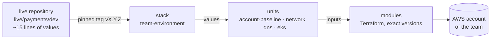

# terragrunt-platform

A reference implementation of an internal infrastructure platform on AWS, built with [Terragrunt stacks](https://docs.terragrunt.com/features/stacks/). A team gets a ready environment from about 15 lines of configuration and one pull request.

The same approach cut provisioning of a new team's environment from **2–3 days of manual work to 30 minutes** at a company with 70+ DevOps engineers. This repository is a clean-room rewrite of the pattern: it contains no code from that project.

## What a team gets

For every `live/<team>/<env>` directory:

| Unit | What it creates |
|---|---|
| `account-baseline` | EBS encryption by default, S3 public access block, IAM password policy, GitHub OIDC provider, read-only **plan** role and environment-scoped **apply** role for CI |
| `network` | VPC with private, public and intra subnets across 3 AZs, NAT, subnet tags for load balancers and Karpenter |
| `dns` | Public Route 53 zone of the environment |
| `eks` | EKS cluster with access entries, core add-ons, a small system node group and Karpenter with an SQS queue for spot interruption events |

## How it is built



- **Modules** are plain Terraform: thin wrappers over `terraform-aws-modules` with exact versions and our defaults.
- **Units** add a contract to a module: values in, outputs out, dependencies with mock outputs so a new environment can be planned before its network exists.
- **Stacks** compose units into the product a team consumes.
- **Live repositories** only hold values and a pinned release. Teams never copy Terraform code.

Details: [docs/architecture.md](docs/architecture.md).

## Repository layout

```
modules/   account-baseline, network, dns, eks — Terraform
units/     one terragrunt.hcl per module, with its contract
stacks/    team-environment/terragrunt.stack.hcl
live/      example live repository: root.hcl and payments/dev
scripts/   pinning check, changed environments, CI helpers
docs/      architecture, quick start, CI
```

In production the catalog (`modules`, `units`, `stacks`) and each domain's `live` directory are separate repositories. Here they share one repository so the whole pattern is visible at once.

## A team's whole environment

```hcl
stack "platform" {
  source = "${local.catalog}//stacks/team-environment?ref=${local.version}"
  path   = "platform"

  values = {
    catalog            = local.catalog
    version            = local.version
    team               = "payments"
    environment        = "dev"
    cidr               = "10.20.0.0/16"
    zone_name          = "payments-dev.example.com"
    kubernetes_version = "1.35"
    github_repository  = "example-org/payments-live"
    state_bucket       = "tfstate-${local.env.locals.account_id}-${local.env.locals.region}"
  }
}
```

Step-by-step onboarding: [docs/quick-start.md](docs/quick-start.md).

## Delivery

- **Plan** in every pull request, one job per changed environment, with a read-only role.
- **Apply** after merge, in a protected GitHub environment that needs an approval.
- **No AWS keys** in CI: GitHub OIDC and short-lived credentials. The apply role trusts only jobs of its environment.
- **Release discipline**: semver tags, exact versions in live repositories, and a CI check that rejects branches and version ranges.

Details: [docs/ci.md](docs/ci.md).

## Local checks

```bash
terraform fmt -check -recursive modules
terragrunt hcl fmt --check
scripts/check-pinned-refs.sh
shellcheck scripts/*.sh
for m in modules/*/; do terraform -chdir="$m" init -backend=false && terraform -chdir="$m" validate; done
```

To generate the example stack against your local copy instead of GitHub, point `PLATFORM_CATALOG` at a local clone that has the `v0.1.0` tag:

```bash
cd live/payments/dev
PLATFORM_CATALOG="git::file://$HOME/src/terragrunt-platform" terragrunt stack generate
terragrunt hcl validate --inputs --strict
```

## Roadmap

- `argocd-bootstrap` unit: hand the cluster over to GitOps right after creation.
- Monitoring and security units: Prometheus stack, Kyverno policies.
- Plan output as a pull request comment.

## Author

Mher Poghosyan, Senior DevOps & Platform Engineer, Yerevan, Armenia.
[LinkedIn](https://www.linkedin.com/in/mher-poghosyan/) · [GitHub](https://github.com/devopsmher)

## License

[MIT](LICENSE)
