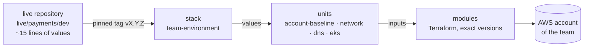

# Architecture

The platform has four layers. Each layer has one job, and each boundary between layers is an explicit contract.

| Layer | What it is | Who changes it |
|---|---|---|
| `modules/` | Plain Terraform. Thin wrappers over well-known modules (`terraform-aws-modules`) with exact versions and our defaults: tags, subnet layout, access rules. | Platform team |
| `units/` | One module plus its contract: which values it needs, which outputs it gives, which units it depends on. | Platform team |
| `stacks/` | A composition of units: everything a team needs in its account. This is the product a team consumes. | Platform team |
| `live/` | One repository per domain. A team writes values and pins a release; it never touches Terraform code. | Domain DevOps team |

## Contracts

Every unit starts with a contract comment, and the code enforces it:

- **values in** — what the stack must pass. A missing value fails at generation time, not after twenty minutes of apply.
- **needs** — outputs of other units, read through `dependency` blocks.
- **outputs** — what other units and teams may rely on. Renaming an output is a breaking change.

Dependencies carry `mock_outputs` for `init`, `validate` and `plan`, so a brand-new environment can be planned before its network exists. Mocks are never allowed for `apply`.

CI runs `terragrunt hcl validate --inputs --strict`: every value a unit passes must match a module variable, and no extra inputs are allowed.

## Versioning

The catalog (modules, units and stacks) is released together under one semver tag:

| Change | Version | Example |
|---|---|---|
| Breaking contract change or resource replacement | MAJOR | renamed value, new subnet layout |
| New optional value, new unit | MINOR | `admin_role_arns`, an Argo CD unit |
| Fix without contract changes | PATCH | a tag, a default |

Live repositories pin an exact tag. An upgrade is a pull request that changes one line, goes to `dev` first and shows its plan before anything changes. `scripts/check-pinned-refs.sh` rejects branches, missing refs and version ranges in CI.

## State

- One S3 bucket per account and region: `tfstate-<account_id>-<region>`.
- One state file per unit: `<team>/<env>/platform/<unit>/terraform.tfstate`.
- Native S3 locking (`use_lockfile`, Terraform 1.10+): no DynamoDB table to manage.
- The generated provider sets `allowed_account_ids`, so a unit can never apply to the wrong account.

## Security defaults

- CI has no AWS keys: GitHub OIDC and two roles per account, read-only for plans and apply for the protected environment only (see [ci.md](ci.md)).
- EKS access goes through access entries; the identity that created the cluster gets no implicit admin rights.
- Account baseline: EBS encryption by default, account-level S3 public access block, IAM password policy.
