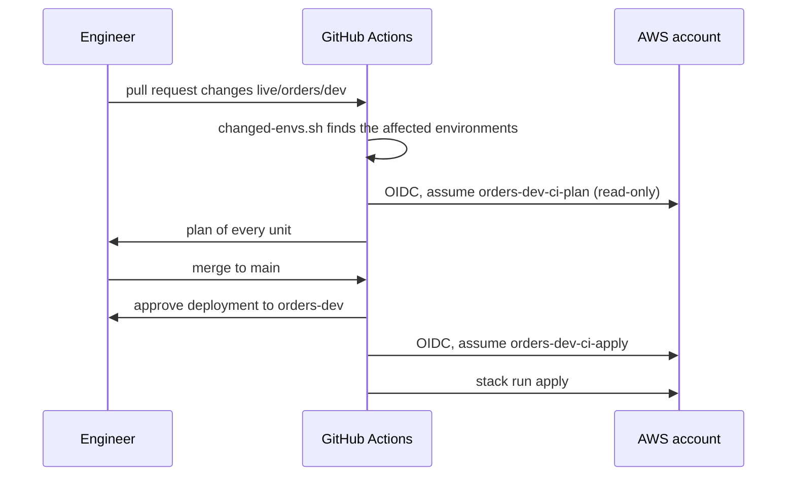

# CI: plan in pull requests, apply after merge, no stored keys

## Roles

Every account gets two roles from the `account-baseline` unit. GitHub Actions exchanges its OIDC token for short-lived credentials; there are no AWS keys in GitHub.

| Role | Trusted `sub` claim | Permissions | Used by |
|---|---|---|---|
| `<team>-<env>-ci-plan` | `repo:<owner>/<repo>:pull_request` | `ReadOnlyAccess`, state read, lock files | `plan.yml` |
| `<team>-<env>-ci-apply` | `repo:<owner>/<repo>:environment:<team>-<env>` | `AdministratorAccess` by default | `apply.yml` |

The apply role trusts a GitHub **environment**, not a branch. A job can only run in that environment after its protection rules pass (required reviewers, allowed branches), so even a workflow change in a pull request cannot assume the apply role.

## Flow

- `scripts/changed-envs.sh` turns the diff into a matrix: one job per changed environment. A change to `live/root.hcl` plans every environment.
- `scripts/env-info.sh` reads the account and region from `env.hcl` and builds the role ARNs by convention.
- Apply jobs share a concurrency group per environment; S3 lock files protect each state file.

## Static checks

`checks.yml` needs no cloud access and runs on every pull request:

| Check | Command |
|---|---|
| Formatting | `terraform fmt -check -recursive modules`, `terragrunt hcl fmt --check` |
| Pinned sources | `scripts/check-pinned-refs.sh` |
| Shell scripts | `shellcheck scripts/*.sh` |
| Modules | `terraform init -backend=false` and `terraform validate` for each module |

In the live repository, `terragrunt hcl validate --inputs --strict` in the generated stack also checks that every unit passes exactly the inputs its module declares.

## Running against real accounts

The plan and apply workflows skip themselves unless the repository variable `ENABLE_AWS_CI` is `true`, so this demo repository stays green without AWS access.
